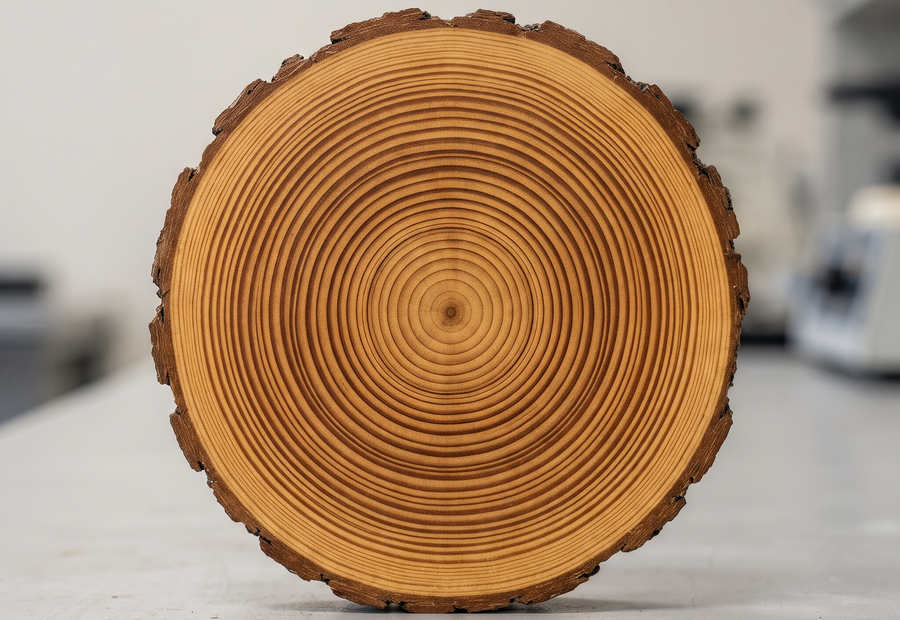
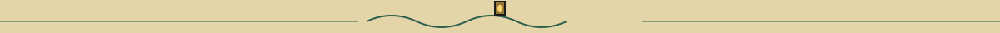

# codeintel-Git-Metadata-Analyzer

Ship log treatment: the title is set in Beau Rivage on a sand plate, ruled beneath, with a small rope knot at the left, and headings read as entries in a station log, with the small horn as the section marker throughout.

Analyzes a git repository's metadata (author email patterns, commit message conventions, branch naming, etc.) to identify potential anomalies indicative of malicious activity, such as impersonation or code injection, providing a risk score. - Focused on Tools for static code analysis, vulnerability scanning, and code quality assurance

## Install
`git clone https://github.com/ShadowGuardAI/codeintel-git-metadata-analyzer`

> **Log margin slip, flagged in place.** The install line above reads git clone https://github.com/ShadowGuardAI/codeintel-git-metadata-analyzer. The name in it is unhyphenated; the correct form is ShadowGuard-AI. The line is preserved exactly as printed and flagged here, never silently fixed.

## Usage
`./codeintel-git-metadata-analyzer [params]`

## Parameters
- `-h`: Show help message and exit
- `--email_threshold`: No description provided
- `--commit_message_pattern`: Regex pattern for commit message validation.
- `--branch_name_pattern`: Regex pattern for branch name validation.
- `--output_file`: Path to output file to save analysis results.
- `--offensive_tools`: No description provided

> **Log margin slip, on the score.** The risk score this tool adds counts kinds, not amounts: one odd address scores the same as half the history. The README promise of a risk score stands above; this slip keeps its measure plain.

## License
Copyright (c) ShadowGuardAI

> **Log margin slip, flagged in place.** The closing line above reads Copyright (c) ShadowGuardAI, the same unhyphenated fault a second time, while the repository LICENSE file carries the MIT License. Both stand as printed.
